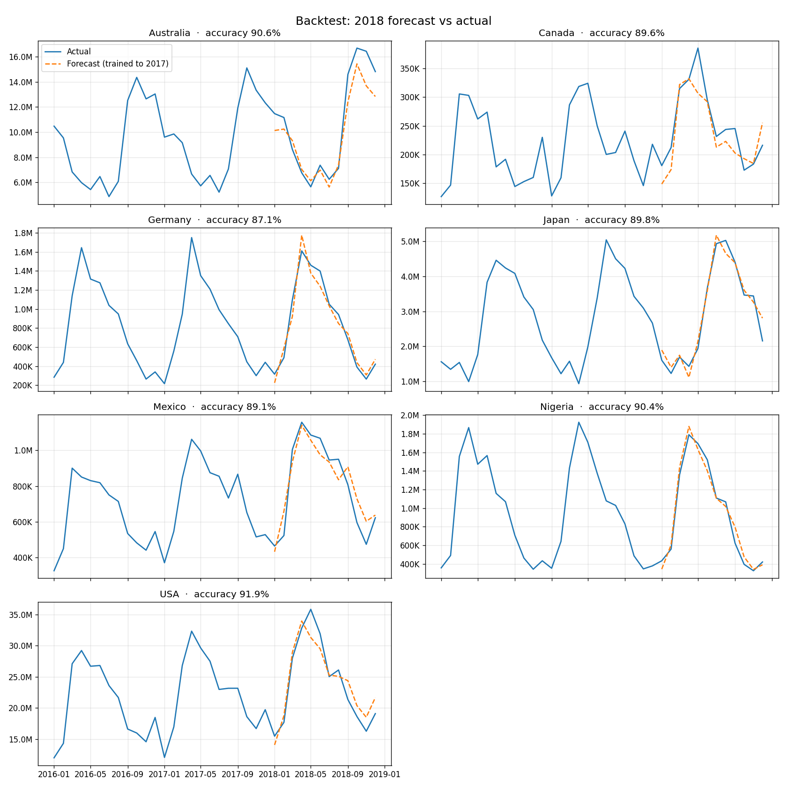
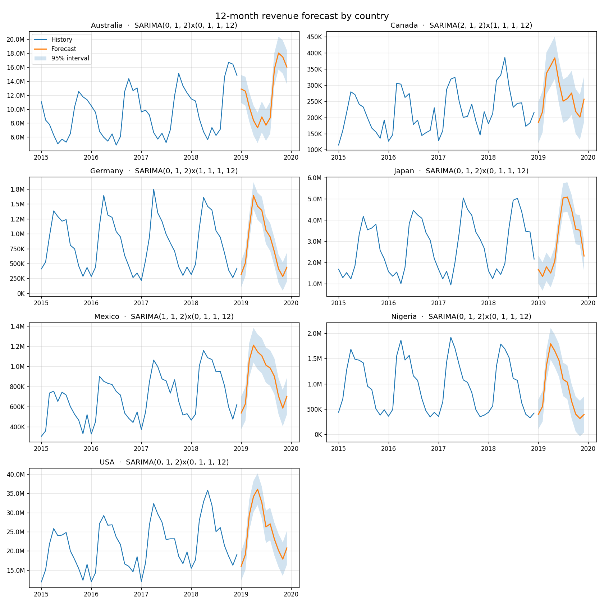

# Sales forecasting for 7 countries (SARIMA)

A Python pipeline that forecasts 12 months of revenue for each of 7 country markets, built during my MSc at Audencia.

**Question:** what will monthly revenue look like over the next 12 months in each market, without a manual Excel process?



## What the notebook does

1. **Load and join:** 7.2 million sales rows from 7 countries (Australia, Canada, Germany, Japan, Mexico, Nigeria, USA), joined with product, geography and manufacturer master data in pandas.
2. **Aggregate:** monthly revenue per country, January 2011 to December 2018.
3. **Dickey-Fuller test:** augmented Dickey-Fuller test on each series to check stationarity and pick the differencing.
4. **Hyperparameter tuning:** grid search over 36 SARIMA orders per country, keeping the lowest AIC.
5. **Backtest:** train on 2011-2017, forecast 2018, compare with actual 2018 revenue.
6. **Forecast:** refit on all data and forecast the next 12 months, with 95% intervals, in matplotlib.

## Results (2018 backtest)

| Country | Accuracy (1 - MAPE) |
|---|---|
| USA | 91.9% |
| Australia | 90.6% |
| Nigeria | 90.4% |
| Japan | 89.8% |
| Canada | 89.6% |
| Mexico | 89.1% |
| Germany | 87.1% |
| **All markets, revenue-weighted (1 - WAPE)** | **91.5%** |



## Run it

```bash
pip install -r requirements.txt
jupyter notebook sales_forecasting.ipynb
```

The raw data is not included: it is course case-study data, and the USA file is larger than GitHub allows.
Put the 7 country CSVs and the 3 `MDM_*.xlsx` master-data files in `data/` to rerun the notebook.

## Stack

Python, pandas, statsmodels (SARIMA via the `SARIMAX` class, `adfuller`), matplotlib.
